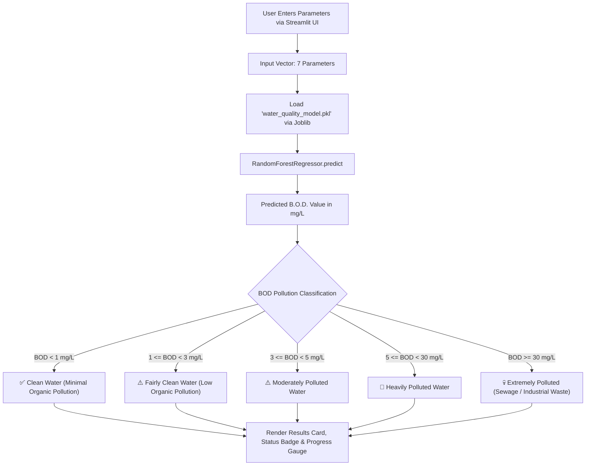

# 🌊 The-DEEP: Water Quality Prediction & Monitoring System
### Comprehensive Technical Documentation & Project Analysis

---

## 1. Executive Summary

**The-DEEP** is an end-to-end Machine Learning-powered Water Quality Assessment and Pollution Prediction system. The application leverages physicochemical and bacteriological water metrics to predict the **Biochemical Oxygen Demand (B.O.D.)** in water bodies and classify water safety into actionable environmental and public health categories.

The project integrates an exploratory data science workflow (Jupyter Notebook) with a production machine learning pipeline and a user-friendly, interactive web application built using **Streamlit**.

---

## 2. Dataset In-Depth Analysis

### 2.1 Dataset Identity & Provenance
* **Dataset Name**: Indian Water Quality Dataset (`water_dataX_updated.csv` / `cleaned_water_data.csv`)
* **Source**: Central Pollution Control Board (**CPCB**), Ministry of Environment, Forest and Climate Change, Government of India (collected under the National Water Quality Monitoring Programme - **NWMP**).
* **Scope**: Multi-regional surface and river water sampling across various states and monitoring stations in India (e.g., Damanganga, Zuari, etc.).
* **Observation Size**: ~1,260 sample records across multiple monitoring sites.

### 2.2 Dataset Attributes & Parameters

| Parameter | Original Column Name | Unit | Type | Role in Project | Description & Environmental Significance |
| :--- | :--- | :--- | :--- | :--- | :--- |
| **Temperature** | `Temp` | °C | Numeric | Input Feature | Water temperature affects dissolved oxygen solubility and biological metabolic rates. |
| **Dissolved Oxygen** | `D.O. (mg/l)` | mg/L | Numeric | Input Feature | Critical indicator of aquatic life survival. Low DO indicates high organic pollution. |
| **pH** | `PH` | pH units (0-14) | Numeric | Input Feature | Measures acidity or alkalinity. Biological processes operate within optimal pH ranges (6.5 - 8.5). |
| **Conductivity** | `CONDUCTIVITY (µmhos/cm)` | µmhos/cm | Numeric | Input Feature | Measures water's capability to pass electrical flow, indicating dissolved inorganic salts/minerals. |
| **Nitrate + Nitrite** | `NITRATENAN N+ NITRITENANN (mg/l)` | mg/L | Numeric | Input Feature | Agricultural runoff and sewage contamination indicators; can trigger algal blooms. |
| **Fecal Coliform** | `FECAL COLIFORM (MPN/100ml)` | MPN/100ml | Numeric | Input Feature | Bacteriological parameter directly associated with human and animal fecal contamination. |
| **Total Coliform** | `TOTAL COLIFORM (MPN/100ml)Mean` | MPN/100ml | Numeric | Input Feature | Aggregate count of environmental and fecal bacteria in the water body. |
| **B.O.D.** | `B.O.D. (mg/l)` | mg/L | Numeric | **Target Variable ($y$)** | **Biochemical Oxygen Demand**: The amount of oxygen consumed by microorganisms decomposing organic matter. Higher values signify severe organic pollution. |
| **Station Code** | `STATION CODE` | Identifier | Categorical | *Dropped* | Metadata identifier for physical sampling station. |
| **Locations** | `LOCATIONS` | Text | Categorical | *Dropped* | Human-readable location description. |
| **State** | `STATE` | Text | Categorical | *Dropped* | Indian State / Union Territory. |
| **Year** | `year` | Year | Numeric | *Dropped* | Year of recording (e.g., 2023). |

### 2.3 Data Cleaning & Preprocessing Pipeline
As implemented in `TISD.ipynb`:
1. **Column Pruning**: Non-predictive metadata columns (`STATION CODE`, `LOCATIONS`, `STATE`, `year`) were dropped to prevent leakage and spurious geographic bias.
2. **String Sanitization & Type Conversion**:
   - Converted string representations of nulls (`"NAN"`, `"nan"`, `" "`) into standard IEEE floating-point `np.nan`.
   - Coerced all feature columns to numerical datatypes using `pd.to_numeric(errors='coerce')`.
3. **Missing Value Imputation**:
   - Imputed missing values using the **Median** of each respective feature column (`df.fillna(df.median())`), providing robust central tendency estimation resilient to extreme outliers.
4. **Distribution Analysis & Log Transformation**:
   - Visualized feature skewness using Seaborn histograms and KDE curves. Positively skewed metrics (coliform counts, conductivity) were analyzed with log scale representation.
5. **Feature Standardization**:
   - Standardized features using `StandardScaler` ($\mu = 0, \sigma = 1$) for models sensitive to scale (such as Linear Regression and SVR).

---

## 3. Machine Learning Algorithms & Modeling Pipeline

### 3.1 Target Variable Definition
The model treats water quality prediction as a continuous regression task, targeting **B.O.D. (Biochemical Oxygen Demand in mg/L)**. B.O.D. is internationally recognized as the benchmark parameter for organic water pollution.

### 3.2 Candidate Algorithms Evaluated
In `TISD.ipynb`, three distinct regression algorithms were evaluated:
1. **Linear Regression (Baseline)**:
   - Evaluated as a baseline linear parametric model.
   - *Limitation*: Underperforms on non-linear ecological and biological interactions.
2. **Support Vector Regression (SVR)**:
   - Evaluated with RBF (Radial Basis Function) kernel for non-linear boundary estimation.
   - *Limitation*: Computationally sensitive to feature scaling and hyperparameter settings.
3. **Random Forest Regressor (Selected Primary Model)**:
   - An ensemble bagging algorithm constructing 100 decision trees with bootstrap aggregation.
   - Superior ability to capture complex non-linear thresholds between biological indicators (coliform) and chemical parameters (conductivity, DO, pH).
   - Inherent resistance to overfitting and outliers.

### 3.3 Selected Final Model: Random Forest Regressor
* **Model Class**: `sklearn.ensemble.RandomForestRegressor`
* **Final Configuration**:
  - `n_estimators`: 100 decision trees
  - `criterion`: `squared_error`
  - `random_state`: 42
  - `bootstrap`: True
* **Training / Test Split**: 80% Training (~1,010 samples), 20% Testing (~250 samples).
* **Hyperparameter Optimization**: Conducted using `RandomizedSearchCV` exploring `n_estimators`, `max_depth`, `min_samples_split`, and `min_samples_leaf` with 5-fold cross-validation.
* **Model Serialization**: Exported using `joblib.dump(best_rf_model, "water_quality_model.pkl")` (13.1 MB model file).

### 3.4 Feature Importance Analysis
Analysis of the trained Random Forest model reveals the relative contribution of each parameter in predicting B.O.D.:

| Rank | Feature | Importance Weight | Physical Interpretation |
| :---: | :--- | :---: | :--- |
| 1 | **Conductivity** (`CONDUCTIVITY (µmhos/cm)`) | **34.68%** | Primary contributor; high ion concentrations strongly correlate with industrial and domestic effluent discharges. |
| 2 | **pH Level** (`PH`) | **18.75%** | Affects biological decay kinetics and indicates industrial acid/base discharges. |
| 3 | **Nitrate + Nitrite** (`NITRATENAN N+ NITRITENANN (mg/l)`) | **16.84%** | Nutrient loading directly fuels microbial decomposition and oxygen demand. |
| 4 | **Dissolved Oxygen** (`D.O. (mg/l)`) | **9.84%** | Direct inverse physical relationship with BOD (as microbial decomposition consumes DO). |
| 5 | **Total Coliform** (`TOTAL COLIFORM (MPN/100ml)Mean`) | **8.53%** | Bacterial presence indicating organic biological matter. |
| 6 | **Fecal Coliform** (`FECAL COLIFORM (MPN/100ml)`) | **8.04%** | Direct indicator of sanitary wastewater contamination. |
| 7 | **Temperature** (`Temp`) | **3.33%** | Influences metabolic rates of decomposing bacteria. |

---

## 4. Web Application & Inference Architecture (`app.py`)

The user-facing system is deployed via **Streamlit** as an interactive environmental decision-support tool.

### 4.1 System Workflow


### 4.2 Water Quality Classification Scale
The application categorizes water quality based on standard environmental and sanitary guidelines:

| Predicted B.O.D. (mg/L) | Classification Status | Color Coding | Practical Implication |
| :---: | :--- | :---: | :--- |
| **< 1.0** | Clean Water | Green | Pristine natural waters, minimal organic pollution, safe for aquatic ecosystems. |
| **1.0 – 2.99** | Fairly Clean Water | Blue | Low organic load; acceptable for treated municipal distribution and recreational use. |
| **3.0 – 4.99** | Moderately Polluted Water | Orange | Noticeable organic waste; aquatic life under mild stress; requires active treatment. |
| **5.0 – 29.99** | Heavily Polluted Water | Red | High organic contamination, significant oxygen depletion; hazardous for aquatic life. |
| **≥ 30.0** | Extremely Polluted Water | Dark Red | Severe untreated sewage or industrial discharge; septic conditions and ecological dead zones. |

---

## 5. Repository Structure

```
DEEP/
└── The-DEEP/
    ├── app.py                     # Streamlit frontend & inference application
    ├── TISD.ipynb                 # End-to-end data pipeline, EDA, training & tuning notebook
    ├── water_quality_model.pkl    # Serialized production RandomForestRegressor model
    ├── requirements.txt           # Python dependencies
    └── PROJECT_DOCUMENTATION.md   # Complete project documentation and analysis
```

---

## 6. Installation & Execution Guide

### 6.1 Prerequisites
* Python 3.9 - 3.12 (Recommended)
* Virtual environment tool (`venv` or `conda`)

### 6.2 Setup Steps

1. **Navigate to the project directory**:
   ```bash
   cd /Users/vishesh/Desktop/DEEP/The-DEEP
   ```

2. **Activate the virtual environment**:
   ```bash
   source .venv/bin/activate
   ```

3. **Install dependencies**:
   ```bash
   pip install -r requirements.txt
   ```

4. **Launch the Streamlit Web Application**:
   ```bash
   streamlit run app.py
   ```

5. Open your browser at `http://localhost:8501` to use the interactive application.

---

## 7. Key Findings & Recommendations for Future Enhancement

1. **Model Explainability (SHAP / LIME)**:
   - Integrate SHAP (SHapley Additive exPlanations) into `app.py` so environmental inspectors can see exactly *why* a specific water sample received its predicted BOD score.
2. **Comprehensive Water Quality Index (WQI)**:
   - Expand the single BOD target to compute the standardized NSF-WQI (National Sanitation Foundation Water Quality Index) or CCME-WQI.
3. **Handling Class Imbalance & Extreme Values**:
   - BOD values can experience extreme right-skewed spikes during industrial discharge events. Incorporating log-transformed target modeling ($\log(1 + y)$) can improve predictive stability for extreme outlier events.
4. **Geospatial & Time-Series Monitoring**:
   - Re-introduce historical monitoring features (station coordinates, dates/years) to support seasonal forecasting and interactive GIS mapping of water bodies.
